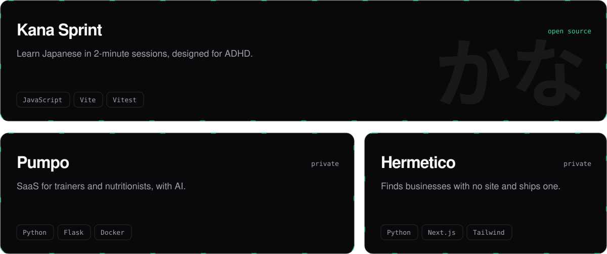
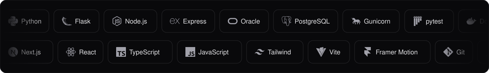

<picture>
  <source media="(prefers-color-scheme: light)" srcset="assets/hero-light.svg" />
  
</picture>

### About

Full-stack developer from Brazil. I like taking an idea all the way to a product: modeling the data, writing the API, designing the interface and shipping it. Back end with Node.js/Express and Python/Flask; front end with React, Next.js, TypeScript and Tailwind. 4+ years in IT, with a background in servers, networks and Docker, so I take features from the database to the deploy.

Fluent in English · basic Japanese (lived in Tokyo) · open to relocation.

 

### Projects

<picture>
  <source media="(prefers-color-scheme: light)" srcset="assets/projects-light.svg" />
  
</picture>

- **[Kana Sprint](https://github.com/Kam4-brisa/kana-sprint)**: learn Japanese in short sessions, with a kana and kanji path, stroke-order checking and JLPT mock tests. Open source.
- **[Pumpo](https://pumpo.app)**: SaaS for personal trainers and nutritionists. Web panel plus a client app, AI that reads meal photos, 12 languages and subscription billing.
- **Hermetico**: finds local businesses without a website on Google Maps, generates a site for each and deploys it, with a WhatsApp outreach bot.
- **Corporate intranet** (at work): TypeScript, React, Node.js and Oracle, with modules for purchasing, finance, logistics, production and HR.

Pumpo, Hermetico and the intranet are private. If you want to see something running, reach out.

 

### Stack

<picture>
  <source media="(prefers-color-scheme: light)" srcset="assets/stack-light.svg" />
  
</picture>

 

### Currently

- Building the company intranet: new modules, REST APIs and reports
- Shipping weekly updates to **Pumpo** and **Hermetico**
- Moving **Kana Sprint** to my own server
- Automated tests on the main flows: `pytest` on the back end, Vitest on the front end

 

### Contact

[LinkedIn](https://www.linkedin.com/in/andr%C3%A9-ramos-da-silva-a119a0193/)

 

### Contributions

<picture>
  <source media="(prefers-color-scheme: dark)" srcset="https://raw.githubusercontent.com/Kam4-brisa/Kam4-brisa/output/github-snake-dark.svg" />
  
</picture>
